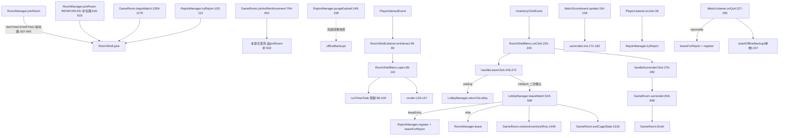

# 新增方法流程详解（对局内退出 GUI / 鹦鹉螺壳）

> 本文档描述**工作区当前（已修复后）代码**的执行流程。所有结论均基于实际读取的源码与
> `git diff` 判定，每个方法都标注了【本次新增】/【本次改动】/【既有】。
> 线程标注依据 `paper/scheduler/SchedulerAdapter.java`：`runTimerTask`/`runLater`/`run`
> 均走 Bukkit 主线程（`Bukkit.getScheduler().runTask*`）。事件回调本身就在主线程。

---

## 0. 范围与判定方法

本特性新增的是一套「对局内玩家主动离局 + 鹦鹉螺壳 GUI」机制。判定方法：

- **【本次新增】**：git diff 中出现且本次引入的类或方法/字段，或既有方法里新增并改变语义的分支。
- **【本次改动】**：既有方法被本特性改动（新增分支、改可见性、改判定）。
- **【既有】**：git diff 中未出现、但被本特性调用的方法（如 `RoomManager.leaveForRejoin`、
  `GameRoom.quitMatch`/`quitMatchKeepEntry`/`tick`/`endCleanup`、`MatchScoreboard.update`、
  `ItemFactory.read`、`RoomManager.leave`、`RoomManager.stashOfflineBackup` 单参版等）。
  即使被本特性调用，也按【既有】标注，不写成新增。

### 本特性新增/改动清单（按影丸位置）

| 文件:行号 | 类型 | 说明 |
|---|---|---|
| `paper/item/RoomShell.java`（整文件） | 【本次新增】 | 壳的 create / isRoomShell / hasShell / give / removeExisting / SLOT_HOTBAR |
| `paper/listener/RoomShellListener.java`（整文件） | 【本次新增】 | 右键开 GUI、防丢弃、防移动、防 F 键换副手、死亡保留 |
| `paper/match/room/RoomShellMenu.java`（整文件） | 【本次新增】 | 9×3 双按钮 GUI、二次确认、刷新任务、点击分发 |
| `paper/match/room/RoomManager.java:919`、`937-940` | 【本次新增 行】 | joinRoom 补位/等待两路补发壳 |
| `paper/match/room/GameRoom.java:1276` | 【本次新增 行】 | beginMatch 补发壳 |
| `paper/match/room/GameRoom.java:729-757` | 【本次新增】 | surrenderStatus + SurrenderStatus record |
| `paper/match/room/GameRoom.java:1318-1323`、`1389` | 【本次改动】 | exitCageState 改 public；characterIdOf 改 public |
| `paper/match/room/GameRoom.java:548-582` | 【本次改动】 | onlineParticipantCount 排除重连占位 |
| `paper/lobby/LobbyManager.java:505-560` | 【本次新增 方法】 | leaveMatch |
| `paper/match/RejoinManager.java:96-118`、`135-160`、`167-174` | 【本次改动】 | tryRejoin 重封存+补发；purgeExpired 双参兜底；hasSession |
| `paper/match/MatchScoreboard.java:154-182` | 【本次新增 行/方法】 | surrenderLine 投降表决行 |
| `paper/item/PDCKeys.java:29-36`、`108`、`188-191` | 【本次新增】 | roomShell() 标记键 |
| `paper/config/ConfigManager.java:972-1009` | 【本次新增】 | roomShell* 读取器 |
| `paper/match/room/GameRoom.java:1713` 一带的 surrender 受理 | 【既有】 | surrender 方法仅 PLAYING 受理（非本次改动） |
| `src/main/resources/messages.yml:232-257` | 【本次新增】 | room-shell.* 文案 |
| `src/main/resources/config.yml:84-94` | 【本次新增】 | room-shell.* 配置 |

> 注：以下要点与当前代码一致：
> - `RoomShellListener.onSwapHands`（防 F 键换副手）：`paper/listener/RoomShellListener.java:149-157`
> - `LobbyManager.leaveMatch` 的 keepEntry 含 `rejoin().rejoinSeconds() > 0`、`restoreInventoryIfAny`、`exitCageState`：`paper/lobby/LobbyManager.java:539-555`
> - `RejoinManager.tryRejoin` 还原后重 `stashAndClearInventory`+`giveCharacterWeapons`+`roomShell().give`、`purgeExpired` 双参 `stashOfflineBackup`、`hasSession`：`paper/match/RejoinManager.java:103-112,149-158,167-174`
> - `GameRoom.onlineParticipantCount` 排除 `hasSession`、`characterIdOf`/`exitCageState` 改 public：`paper/match/room/GameRoom.java:548-582,1318-1323,1389`
> - `RoomShellMenu.surrenderButton` 可用条件收紧为 `phase == PLAYING`：`paper/match/room/RoomShellMenu.java:178-183`

---

## 1. 调用图总览

---

## 2. 按类分节

### 2.1 `RoomShell`（paper/item/RoomShell.java）

#### 2.1.1 `RoomShell(plugin)` 构造器 — `:43`
1. 签名与位置：`public RoomShell(TaketoriPlugin plugin)` — `paper/item/RoomShell.java:43`
2. 类型：【本次新增】类
3. 调用者：`TaketoriPlugin.roomShell()` 懒加载创建（`:1003-1009`，见 TaketoriPlugin.java diff）
4. 逐步流程：保存 plugin 引用。
5. 早退/边界：无。
6. 副作用：无（仅存引用）。
7. 线程：主线程。

#### 2.1.2 `SLOT_HOTBAR` 常量 — `:39`
- 类型：【本次新增】常量。壳落点 = 快捷栏第 9 格（index 8）。

#### 2.1.3 `enabled()` — `:47`
1. 位置：`paper/item/RoomShell.java:47`
2. 类型：【本次新增】
3. 调用者：`give`（`RoomShell.java:102`）
4. 流程：返回 `plugin.config().roomShellEnabled()`。
5. 早退：无。
6. 副作用：无。
7. 线程：主线程。

#### 2.1.4 `create()` — `:52`
1. 位置：`paper/item/RoomShell.java:52`
2. 类型：【本次新增】
3. 调用者：`give`（`RoomShell.java:112`）
4. 流程：
   - 用 `plugin.config().roomShellMaterial()` 造 `ItemStack`；
   - `editMeta` 设 displayName（MiniMessage 解析 `roomShellName()`）、lore（`roomShellLore()`）；
   - 在 PDC 写入 `PDCKeys.roomShell()` = BYTE 1 标记（`:61`）。
5. 早退：无。
6. 副作用：新造一个带 PDC 标记的壳 ItemStack（不改玩家背包）。
7. 线程：主线程。

#### 2.1.5 `isRoomShell(ItemStack)` — `:67`
1. 位置：`paper/item/RoomShell.java:67`
2. 类型：【本次新增】
3. 调用者：几乎所有监听器与 `hasShell`、`give`、`removeExisting`。
4. 流程：null/AIR/无 meta 返回 false；读 PDC `roomShell()` BYTE，非 null 即识别（**只认 PDC**，不认名字/Lore）。
5. 早退：`stack == null`、`getType()==AIR`、`!hasItemMeta()`、`meta == null` → false。
6. 副作用：无。
7. 线程：主线程。

#### 2.1.6 `hasShell(Player)` — `:80`
1. 位置：`paper/item/RoomShell.java:80`
2. 类型：【本次新增】
3. 调用者：`RoomShellListener.onDeath`（`:175`）
4. 流程：遍历玩家背包所有槽位，任一为壳即返回 true。
5. 早退：`player == null` → false。
6. 副作用：无。
7. 线程：主线程。

#### 2.1.7 `give(Player)` — `:101`
1. 位置：`paper/item/RoomShell.java:101`
2. 类型：【本次新增】
3. 调用者：发壳四处（joinRoom 等待路 `:940`、joinRoom 补位路 `:919`、beginMatch `:1276`、tryRejoin `:112`）
4. 逐步流程：
   - 早退：`player==null || !isOnline() || !enabled()` → 返回 false（`:102-104`）；
   - 读 `inv.getItem(SLOT_HOTBAR)`，若已是壳 → 返回 false（不重复，`:107-109`）；
   - 否则 `removeExisting(inv)` 清掉背包里任何旧壳（`:111`）；
   - `inv.setItem(SLOT_HOTBAR, create())`（`:112`）。
5. 早退/边界：见上 enable/在线/已存在三个分支。
6. 副作用：**写玩家背包第 9 格**（`backups` 由 stash 流程独立管理，此处不动）。
   关键约定：调用点都保证在 `stashAndClearInventory` 之后调用，避免被 `inv.clear()` 抹掉。
7. 线程：主线程。

#### 2.1.8 `removeExisting(PlayerInventory)` — `:117`
1. 位置：`paper/item/RoomShell.java:117`
2. 类型：【本次新增】
3. 调用者：`give`（`:111`）
4. 流程：遍历所有槽位，是壳则置 null（`:118-124`）。
5. 早退：无。
6. 副作用：清空背包内所有壳。
7. 线程：主线程。

---

### 2.2 `RoomShellListener`（paper/listener/RoomShellListener.java）

#### 2.2.1 `onInteract(PlayerInteractEvent)` — `:48`
1. 位置：`paper/listener/RoomShellListener.java:48`
2. 类型：【本次新增】
3. 调用者：Bukkit 事件 `PlayerInteractEvent`（右键）
4. 逐步流程：
   - 仅 `RIGHT_CLICK_AIR`/`RIGHT_CLICK_BLOCK`，否则 return（`:50-53`）；
   - 只认主手（`getHand() != HAND` 跳过，`:54-56`）；
   - 主手物品不是壳则 return（`:57-60`）；
   - `event.setCancelled(true)` 拦截原版行为（`:61`）；
   - `roomOf(player)`，无房间则提示 `room-shell.not-in-room` 并 return（`:63-67`）；
   - `plugin.roomShellMenu().open(player)`（`:68`）。
5. 早退：动作非右键、副手、非壳、不在房间。
6. 副作用：取消原版交互；打开 GUI。
7. 线程：主线程。

#### 2.2.2 `onDrop(PlayerDropItemEvent)` — `:73`
1. 位置：`paper/listener/RoomShellListener.java:73`
2. 类型：【本次新增】
3. 调用者：Bukkit `PlayerDropItemEvent`
4. 流程：掉落物是壳则 `setCancelled(true)` 并提示 `room-shell.undroppable`（`:75-79`）。
5. 早退：掉落物非壳。
6. 副作用：取消丢弃。
7. 线程：主线程。

#### 2.2.3 `onInventoryClick(InventoryClickEvent)` — `:84`
1. 位置：`paper/listener/RoomShellListener.java:84`
2. 类型：【本次新增】
3. 调用者：Bukkit `InventoryClickEvent`
4. 逐步流程：
   - 非 Player 点击 return（`:86-88`）；
   - 判断是否在自己背包（TopInventory holder 是 PlayerInventory，`:90-91`）；
   - 容器场景：涉及壳（`shellInvolved`）则取消并提示 `room-shell.locked`（`:92-96`）；
   - 自己背包场景：涉及壳也取消（`:97-99`）；此分支**允许开自己背包时点击其它物品**，仅锁壳本身。
5. 早退：非玩家、不涉及壳。
6. 副作用：取消移动/入容器。
7. 线程：主线程。

#### 2.2.4 `shellInvolved(InventoryClickEvent, Player)` — `:103`
1. 位置：`paper/listener/RoomShellListener.java:103`
2. 类型：【本次新增】
3. 调用者：`onInventoryClick`（`:104,108`）
4. 流程：当前格或光标是壳 → true；动作为 `HOTBAR_SWAP`/`HOTBAR_MOVE_AND_READD` 时检查快捷栏交换键/副手是否壳（`:108-115`）。
5. 早退：都不涉及壳 → false。
6. 副作用：无。
7. 线程：主线程。

#### 2.2.5 `onInventoryDrag(InventoryDragEvent)` — `:125`
1. 位置：`paper/listener/RoomShellListener.java:125`
2. 类型：【本次新增】
3. 调用者：Bukkit `InventoryDragEvent`
4. 流程：自己背包拖拽 return（`:130-133`）；旧光标是壳则取消并提示 `room-shell.locked`（`:134-138`）。
5. 早退：自己背包内拖拽。
6. 副作用：取消拖入容器。
7. 线程：主线程。
> 防护漏洞覆盖（REVIEW 点 E）：本类覆盖了 DROP、InventoryClick（当前格/光标/HOTBAR_SWAP/HOTBAR_MOVE_AND_READD）、InventoryDrag、F 键 `PlayerSwapHandItemsEvent` 五条。未单独覆盖 SWAP_WITH_CURSOR/NUMBER_KEY 的「入容器」——但 NUMBER_KEY 属 Hotbar 交换，已在 `shellInvolved` 的 `HOTBAR_SWAP` 路径拦截；SWAP_WITH_CURSOR 在容器场景被「涉及壳即取消」覆盖。

#### 2.2.6 `onSwapHands(PlayerSwapHandItemsEvent)` — `:149`
1. 位置：`paper/listener/RoomShellListener.java:149`
2. 类型：【本次新增】（修复：拦截 F 键把壳换到副手）
3. 调用者：Bukkit `PlayerSwapHandItemsEvent`
4. 流程：主手或副手任一为壳则 `setCancelled(true)` 并提示 `room-shell.locked`（`:151-156`）。
5. 早退：主手副手都不是壳。
6. 副作用：取消副手交换。
7. 线程：主线程。

#### 2.2.7 `onDeath(PlayerDeathEvent)` — `:167`
1. 位置：`paper/listener/RoomShellListener.java:167`
2. 类型：【本次新增】
3. 调用者：Bukkit `PlayerDeathEvent`
4. 逐步流程：
   - `event.getKeepInventory()` 为 true → 直接 return（世界规则已保留，`:170-172`）；
   - 否则从 `event.getDrops()` 移除所有壳（`:174`）；
   - 若玩家身上仍无壳（`hasShell` 为 false）再 `give(player)`（`:175-177`）。
5. 早退：keepInventory true。
6. 副作用：死亡掉落列表剔除壳、必要时补壳。两条分支（keep true/false）都成立（REVIEW 点 E 已覆盖）。
7. 线程：主线程。

---

### 2.3 `RoomShellMenu`（paper/match/room/RoomShellMenu.java）

#### 2.3.1 `open(Player)` — `:85`
1. 位置：`paper/match/room/RoomShellMenu.java:85`
2. 类型：【本次新增】
3. 调用者：`RoomShellListener.onInteract`（`:68`）
4. 逐步流程：
   - null/离线 return（`:86-88`）；
   - new `Session(player.getUniqueId())`（`:89`）；
   - `Bukkit.createInventory(session, SIZE=27, title)`（`:90-91`）；
   - `render(session, player)`（`:93`）；
   - `player.openInventory(inventory)`（`:94`）；
   - 启动 `plugin.scheduler().runTimerTask(刷新闭包, 20, 20)`（`:96-109`）：闭包每秒检查 viewer 是否仍在线、是否还在看本 session（`isViewing`），否则 `cancel`；超时则清确认态；再 `render`。
5. 早退：null/离线。
6. 副作用：创建 InventoryHolder 会话、打开界面、起主线程周期刷新任务。
7. 线程：open 在主线程；刷新任务由 `runTimerTask` 走**主线程**（`SchedulerAdapter.java:63-66`）。

#### 2.3.2 `isViewing` / `cancel` — `:112` / `:117`
- `isViewing`（`:112`）：比较打开界面 TopInventory 的 holder 是否为同一 Session。
- `cancel`（`:117`）：`refreshTask.cancel()` 并置 null。**关闭界面即取消**（InventoryCloseEvent 虽未显式监听，但闭包每 tick 检测到非 viewing 即 cancel，REVIEW 点 F：refreshTask 一定被取消）。

#### 2.3.3 `render(Session, Player)` — `:126`
1. 位置：`paper/match/room/RoomShellMenu.java:126`
2. 类型：【本次新增】
3. 调用者：`open`（`:93`）、刷新任务（`:108`）、`onClick`（`:242`）
4. 流程：`inv.clear()`；填 GRAY_STAINED_GLASS_PANE 背景；计算 `inRoom/inMatch/waiting/team`；在 SLOT_LEAVE(11)/SLOT_SURRENDER(15)/SLOT_INFO(13) 各放按钮（`:144-146`）。每次全量重画（票数/阶段实时读房间）。
5. 早退：无。
6. 副作用：重写界面内容（无持久状态）。
7. 线程：主线程。

#### 2.3.4 `leaveButton` / `surrenderButton` / `infoButton` — `:150` / `:178` / `:199`
- `leaveButton`（`:150`）：非 waiting 非 inMatch → BARRIER 不可用（`:151-156`）；确认态中 → RED_TERRACOTTA 确认（`:166-168`）；否则 LIME_DYE 初始（`:159-165`）。
- `surrenderButton`（`:178`）：`room==null || team==null || phase != PLAYING` → GRAY_DYE 置灰（`:179-183`）；否则 RED_BANNER 并显示票进度（`:184-195`）。**CAGED 阶段置灰**，因 `GameRoom.surrender` 仅在 PLAYING 受理。
- `infoButton`（`:199`）：显示阶段 + 本队 + 票数（仅 inMatch）。

#### 2.3.5 `onClick(InventoryClickEvent)` — `:224`
1. 位置：`paper/match/room/RoomShellMenu.java:224`
2. 类型：【本次新增】
3. 调用者：Bukkit `InventoryClickEvent`
4. 流程：
   - holder 非本 Session return（`:226-228`）；
   - `setCancelled(true)`（`:229`）；
   - 非玩家 return；
   - 只认 `session.viewer` 本人（`:233-235`）；
   - rawSlot==11 → `handleLeaveClick`；==15 → `handleSurrenderClick`；最后 `render`（`:236-242`）。
5. 早退：非本持有者、非本人。
6. 副作用：分发点击。
7. 线程：主线程。

#### 2.3.6 `handleLeaveClick(Session, Player)` — `:246`
1. 位置：`paper/match/room/RoomShellMenu.java:246`
2. 类型：【本次新增】
3. 调用者：`onClick`（`:238`）
4. 逐步流程：
   - `roomOf(player)`，无房间 return；
   - waiting（WAITING/STARTING）→ 关界面 + `returnToLobby`（`:253-257`）；
   - 非 inMatch（CAGED/PLAYING 之外，即 ENDING 等）return（`:258-262`）；
   - 确认态中（`leaveConfirmUntilMillis>0 且未过期`）→ 清确认态、关界面、`leaveMatch`（`:263-272`）；
   - 非确认态 → 设置 `leaveConfirmUntilMillis = now + 5000ms`，return 等再点（`:265-268`）。
5. 早退：见各分支。
6. 副作用：写 session 确认时间戳；触发离局/退房。
7. 线程：主线程。

#### 2.3.7 `handleSurrenderClick(Player)` — `:276`
1. 位置：`paper/match/room/RoomShellMenu.java:276`
2. 类型：【本次新增】
3. 调用者：`onClick`（`:240`）
4. 流程：`roomOf`、无房间或无队伍 return（`:277-280`）；否则 `room.surrender(player)`（`:281`）。
5. 早退：不在房间/无队伍。
6. 副作用：发起/记票投降。
7. 线程：主线程。

---

### 2.4 `LobbyManager.leaveMatch(Player)` — `:524`【本次新增 方法】

1. 签名与位置：`public void leaveMatch(Player player)` — `paper/lobby/LobbyManager.java:524`
2. 类型：【本次新增】（统一入口，供 GUI 与 `/taketori leave` 对局中分支调用）
3. 调用者：
   - `RoomShellMenu.handleLeaveClick`（确认后，`:272`）
   - `LobbyManager.returnToLobby` 对局中分支（`:490`）
4. 逐步流程：
   - 早退：`player==null || !isOnline()`（`:525-527`）；
   - `roomOf(player)`，无房间 → `sendToLobby` 并 return（`:528-532`）；
   - `team = room.teamOf(uuid)`（`:533`）；
   - 计算 `keepEntry = roomLeaveRejoinWindow() && rejoin().rejoinSeconds() > 0 && team != null`（`:539-541`）；
   - keepEntry 真：`rejoin().register(uuid, room, team)` + `rooms().leaveForRejoin(uuid)`（保留 teams 条目占位）（`:542-545`）；
   - 否则：`rooms().leave(uuid)`（立即释放）（`:546-548`）；
   - `room.restoreInventoryIfAny(player)`（把开局前封存背包还玩家，消费快照）（`:551`）；
   - `room.exitCageState(player)`（解笼内无敌/缓慢）（`:555`）；
   - 广播 `room.leave-match-broadcast`、提示 `room.leave-match-rejoinable` 或 `room.leave-match`（`:556-558`）；
   - `sendToLobby(player)`（`:559`）。
5. 早退/边界：null/离线、无房间、keepEntry 三条件缺一则走立即释放。
6. 副作用：【关键】背包快照被消费（不再残留覆盖大厅物品）；`teams` 条目保留或移除；`playerRooms` 映射移除（`leaveForRejoin`/`leave` 内部）；解除 invulnerable；记分板隐藏（`sendToLobby`）；重连会话登记（keepEntry 时）。
7. 线程：主线程。

---

### 2.5 `RejoinManager`（paper/match/RejoinManager.java）

#### 2.5.1 `tryRejoin(Player)` — `:67`【改动】
1. 位置：`paper/match/RejoinManager.java:67`
2. 类型：【本次改动】（新增「还原后重封存 + 补发装备与壳」序列）
3. 调用者：`PlayerListener.onJoin`（`:39`）
4. 逐步流程：
   - 早退：null/离线、无 session、session 过期（`:68-80`）；
   - `room = rooms().room(session.roomId())`，房间不存在/队伍不符/不在运行 → `quitMatch(id)` 释放并返回（`:81-89`）；
   - `attachAfterRejoin(player, room)` 绑定映射（`:91`）；
   - 传送回本队出生点（`:92-95`）；
   - **还原**：`restoreInventoryIfAny(player)` + `restoreOfflineBackup(player)`（`:103-104`）；
   - **重新封存**：`stashAndClearInventory(player)`（`:106`）；
   - 按角色 `giveCharacterWeapons`（`:107-110`）；
   - `roomShell().give(player)` 补壳（`:112`）；
   - `scoreboard().showTo`、`broadcastMessage("rejoin.back")`、提示 `rejoin.welcome`、返回 true（`:113-118`）。
5. 早退：无 session/过期/房间失效。
6. 副作用：playerRooms 重绑、背包重封存+补发、壳补发、记分板、广播。
7. 线程：主线程（在 onJoin MONITOR 事件内同步执行）。

#### 2.5.2 `purgeExpired()` — `:135`【改动】
1. 位置：`paper/match/RejoinManager.java:135`
2. 类型：【本次改动】（新增双参 `stashOfflineBackup` 兜底转移快照）
3. 调用者：`GameRoom.tick`（既有，未在本 diff 改）
4. 流程：遍历 sessions，过期则 remove；`room.quitMatch(key)` 释放 teams 条目（`:149`）；`extractBackup(key)` 取房间内快照，非 null 则 `stashOfflineBackup(key, backup)` 转全局暂存（`:155-157`）。
5. 早退：`room == null` → continue（不抛，但也不会转移，REVIEW 点 D 边界：房间已回收则快照随世界消失，已无法找回）。
6. 副作用：sessions 清理、teams 条目释放、快照兜底入 offlineBackups。
7. 线程：主线程（tick 在主线程）。

#### 2.5.3 `hasSession(UUID)` — `:168`【本次新增】
1. 位置：`paper/match/RejoinManager.java:168`
2. 类型：【本次新增】
3. 调用者：`GameRoom.onlineParticipantCount`（`:562` 一带）
4. 流程：取 session，非 null 且 `expiresAtMillis >= now` 即 true（`:169-173`）。
5. 早退：null id。
6. 副作用：无。
7. 线程：主线程。

> 其它既有方法（`register:49`、`rejoinSeconds:41`、`forgetRoom:122`、`clearAll:163`、`size:177`）非本次改动，略。

---

### 2.6 `GameRoom`（paper/match/room/GameRoom.java）

#### 2.6.1 `onlineParticipantCount()` — `:548`【改动】
1. 位置：`paper/match/room/GameRoom.java:548`
2. 类型：【本次改动】（排除 `rejoin.hasSession(uuid)` 的离局占位）
3. 调用者：`abortEmpty`/空房回收（既有，未改动）
4. 流程：`all = waiting ∪ teams.keySet()`；遍历每个 uuid：`player==null || !online` 跳过；**`rejoin.hasSession(uuid)` 则跳过**（已离局占位不算在场）（`:560-568`）；否则 count++。
5. 早退：离线/有重连会话。
6. 副作用：无（只读计数）。
7. 线程：主线程。

#### 2.6.2 `surrenderStatus(TeamId)` — `:729`【本次新增】
1. 位置：`paper/match/room/GameRoom.java:729`
2. 类型：【本次新增】+ `SurrenderStatus` record（`:756`）
3. 调用者：`MatchScoreboard.surrenderLine`（`:176`）、`RoomShellMenu.surrenderButton/infoButton`（`:184,209`）
4. 流程：
   - team==null → null；取 `surrenderVotes.get(team)`，无 → null；
   - `now > deadlineMillis` → null（过期等同无表决）；
   - 计算 confirmed：遍历 vote.confirmed()，仅算在线且仍在本队者（`:742-748`）；
   - `online = teamPlayers(team).size()`；`need = max(1, (online+1)/2)`（`:749-750`）；
   - `remainingSeconds = (deadlineMillis-now+999)/1000`（`:751`）。
5. 早退：无 team/无 vote/过期。
6. 副作用：无（只读快照）。
7. 线程：主线程。

#### 2.6.3 `surrender(Player)` — `:816`【既有】
- 受理条件：`phase != PLAYING` → return（`:817`）；`team==null` → return（`:821`）。
- 首次/过期则 new SurrenderVote(now+30s)（`:826-829`）；加票并清离线/离队旧票（`:830-835`）；`need=max(1,(online+1)/2)`（`:837`）；达票则 `surrenderVotes.remove` + 广播 + `finish(对方队)`（`:839-844`）；否则向同队发含 `[同意投降]` run_command 的提示（`:846-854`）。
- 与 `surrenderStatus` 的 need 口径**完全一致**（`(online+1)/2`），REVIEW 点 G 已一致。

#### 2.6.4 `beginMatch(boolean)` 发壳行 — `:1276`【新增 行】
- 既有方法 `beginMatch`（`:1150`）本次未改签名，仅在循环里 `stashAndClearInventory`（`:1269`）→ `giveCharacterWeapons`（`:1272`）→ **`plugin.roomShell().give(player)`（`:1276`）** 补发壳（清包后发，确保落第 9 格）。

#### 2.6.5 `joinAsReinforcement(Player, TeamId)` — `:794`【既有】
- 本身**不发壳**；壳由调用方 `joinRoom:919` 补发（见 2.7）。内部 `stashAndClearInventory`+`giveCharacterWeapons`+传送+记分板+出生增益（`:795-809`）。

#### 2.6.6 `exitCageState(Player)` — `:1318`【改动：private→public】
- 仅对 SURVIVAL/ADVENTURE 关 `setInvulnerable(false)`（`:1321-1324`）；幂等。被 `leaveMatch` 调用（`:555`）。

#### 2.6.7 `characterIdOf(UUID)` — `:1389`【改动：private→public】
- 经 `config().characters().profileOrNull(uuid)` 取绑定角色 id；被 `tryRejoin`（`:107`）调用。

#### 2.6.8 背包相关【既有】
- `stashAndClearInventory`（`:1405`）：无快照时拍 InventorySnapshot（背包/盔甲/副手/血量/饥饿/经验/模式/飞行/药水）并清包+清药水+关飞行。
- `extractBackup`（`:1444`）：`backups.remove(uuid)`，取走快照。
- `restoreInventoryIfAny`（`:1449`）：移除并 `restoreTo`；若快照有自带药水则 `preservePotions`（`:1459-1461`）。

---

### 2.7 `RoomManager`（paper/match/room/RoomManager.java）

#### 2.7.1 `joinRoom(Player, String)` 发壳两路 — `:919`/`:940`【新增 行】
1. 位置：`paper/match/room/RoomManager.java:886`；发壳在 REINFORCED 路 `:919`、WAITING 等待路 `:940`
2. 类型：【既有方法 + 本次新增行】
3. 调用者：`/taketori join`、RoomListMenu 等（既有）
4. 流程：
   - 补位路（CAGED/PLAYING + 有 openTeam）：`joinAsReinforcement` 后 `roomShell().give(player)`（`:916-919`）；
   - 等待路：`addWaiting` → `stashAndClearInventory` → `roomShell().give(player)`（`:935-940`）。
5. 早退：NOT_FOUND/IN_GAME/STARTED/FULL 等既有分支（REVIEW 点 B：换房/补位/等待三路都发壳，无「等待期没壳」窗口）。
6. 副作用：写背包、封存、playerRooms 绑定。
7. 线程：主线程。

> `leaveForRejoin`（`:1046`）、`leave`（未改动，约 `:1000` 一带）、`stashOfflineBackup` 双参（`:1091`）、`restoreOfflineBackup`（`:1109`）、`attachAfterRejoin`（`:1448`）均为既有，本次未改逻辑（仅 `leaveMatch`/`MatchListener` 调用其既有能力）。

---

### 2.8 `MatchScoreboard.surrenderLine(Player)` — `:171`【本次新增 方法】

1. 位置：`paper/match/MatchScoreboard.java:171`（调用点 `:154-158` 在 `update` 内）
2. 类型：【本次新增】
3. 调用者：`MatchScoreboard.update`（既有的 `update`，`:154` 新增一行调用）
4. 流程：取 `room.teamOf`；team==null → null；`surrenderStatus(team)`==null → null；否则返回 `"投降表决: confirmed/need (剩 Xs)"`（`:180-181`）。
5. 早退：无队伍/无表决。
6. 副作用：无（只读）。`uniqueEntry` 保证行唯一（REVIEW 点 G：行数变化不重复）。
7. 线程：主线程。

---

### 2.9 配置/访问器（既有类 + 本次新增）

- `PDCKeys.roomShell()`（`:188`，键 `"room_shell"`）：壳 PDC 标记键。
- `ConfigManager.roomShellEnabled/Material/Name/Lore/roomLeaveRejoinWindow`（`:972-1009`）：从 config.yml `room-shell.*` 读取。
- `TaketoriPlugin.roomShell()` / `roomShellMenu()`（`:1003-1009`）：懒加载；并在 `onEnable` 注册监听器（diff 见 `TaketoriPlugin.java:248-252` 注册 `RoomShellListener` 与 `RoomShellMenu`）。

---

## 3. 关键流程逐步时序（8 条）

### 3.1 进房发壳（等待路）
1. 玩家执行 `/taketori join <id>`，`RoomManager.joinRoom`（`:886`）。
2. 相位 WAITING/STARTING 分支：`target.addWaiting(player)`（`:935`）。
3. `playerRooms.put(uuid, target)`（`:936`）。
4. `target.stashAndClearInventory(player)` — 封存自带背包（`:937`，`GameRoom.java:1405`）。
5. `plugin.roomShell().give(player)` — 清旧壳、写第 9 格（`:940`，`RoomShell.java:101-112`）。
6. 传送等待区（`:942` 起）。

**线程**：主线程。**涉及状态**：`waiting` 集合、`playerRooms`、`backups`（快照）、玩家背包第 9 格。

### 3.2 开局补发（beginMatch）
1. `beginMatch(force)`（`:1150`）遍历 `teams` 参赛者（`:1258`）。
2. 每位：`stashAndClearInventory`（清掉等待期发的壳+武器，`:1269`）。
3. `giveCharacterWeapons`（`:1272`）。
4. `plugin.roomShell().give(player)`（`:1276`）— 武器之后发，壳稳定落第 9 格。
5. 传送、记分板、`applySpawnBuff`（`:1277-1284`）。
6. CAGED：`enterCageState`（`:1299` 一带，设 invulnerable）。

**线程**：主线程。**涉及状态**：`backups`（重拍快照）、玩家背包、phase（→CAGED/PLAYING）。

### 3.3 对局中补位发壳（REINFORCED）
1. `joinRoom` 检测到 CAGED/PLAYING + `reinforcementTeam()` 有空缺（`:905-909`）。
2. 若从旧等待房转来：`removeWaiting`+`restoreInventoryIfAny`（`:910-915`）。
3. `target.joinAsReinforcement(player, openTeam)`（`:916`，内部 stash+发武器+传送+记分板）。
4. `playerRooms.put`（`:917`）。
5. `plugin.roomShell().give(player)`（`:919`）— 补位路径不经过 addWaiting，故此处必补。

**线程**：主线程。**涉及状态**：`teams`、`playerRooms`、`backups`、背包第 9 格。

### 3.4 右键开 GUI
1. `PlayerInteractEvent` → `RoomShellListener.onInteract`（`:48`）：校验右键+主手+壳，cancel 原版（`:61`），校验在房间内（`:63-67`）。
2. `roomShellMenu().open(player)`（`:85`）：建 Session（InventoryHolder）、`Bukkit.createInventory`（SIZE=27）、`render`（`:126` 画三按钮）、`openInventory`、起 `runTimerTask` 刷新（20t/20t，`:96-109`）。
3. 刷新任务每 tick：检测 viewer 仍在线且 isViewing（`:97-99`），否则 cancel；超时清确认态（`:104-107`）；再 render（`:108`）。
4. 关闭界面：下一 tick 闭包检测到非 viewing → `cancel`（`:100-101`），**refreshTask 一定被取消**。

**线程**：open 与点击均在主线程；刷新任务经 `runTimerTask` 走主线程。**涉及状态**：Session（确认时间戳、refreshTask）、Inventory。

### 3.5 退出二次确认 → 离局（inMatch）
1. 玩家点 SLOT_LEAVE(11) → `onClick`（`:224`）→ `handleLeaveClick`（`:246`）。
2. 非 waiting 非 inMatch 直接 return；inMatch 进入确认逻辑（`:258-262`）。
3. 非确认态：设 `session.leaveConfirmUntilMillis = now + 5000ms`，return（`:265-268`）——按钮变 RED_TERRACOTTA（render 读到确认态，`:157-168`）。
4. 5s 内再点：确认态中 → 清时间戳、`closeInventory`、`leaveMatch(player)`（`:270-272`）。
5. `leaveMatch`（`:524`）：
   - `keepEntry = roomLeaveRejoinWindow() && rejoin().rejoinSeconds()>0 && team!=null`（`:539-541`）；
   - keepEntry → `register` + `leaveForRejoin`（保留 teams 条目）；否则 `leave`（`:542-548`）；
   - `restoreInventoryIfAny(player)`（还背包，消费快照，`:551`）；
   - `exitCageState(player)`（解无敌，`:555`）；
   - 广播 + 提示（`:556-558`）；
   - `sendToLobby(player)`（`:559`，清药水、传送、隐藏记分板）。
6. 5s 超时未再点：刷新任务把 `leaveConfirmUntilMillis` 归零（`:104-107`），按钮弹回初始。

**线程**：主线程。**涉及状态**：`sessions`（RejoinManager）、`teams`、playerRooms、`backups`（消费）、invulnerable、记分板、玩家背包。

### 3.6 等待期退出房间（waiting 分支）
1. 点 SLOT_LEAVE → `handleLeaveClick`（`:246`）：`waiting` 为真 → `closeInventory` + `returnToLobby(player)`（`:253-256`）。
2. `returnToLobby`（`:469`）：观众先退观战；房间内 WAITING/STARTING → `rooms().leave(uuid)` 释放等待名额（`:496`）、广播 `room.leave-broadcast`、提示 `room.leave`、`sendToLobby`。
3. **与流程 5 差异**：waiting 分支**不**走 `leaveMatch`，不登记重连会话、不 `exitCageState`（等待期无笼内无敌）、不 `restoreInventoryIfAny`（等待期已无对局装备，背包清包状态由 leave 流程处理）；仅释放等待名额回大厅。

**线程**：主线程。**涉及状态**：`waiting` 集合、playerRooms、记分板。

### 3.7 投降
1. 点 SLOT_SURRENDER(15) → `handleSurrenderClick`（`:276`）→ `room.surrender(player)`（`:281`）。
2. `surrender`（`:816`）：仅 PLAYING 受理（CAGED 静默 return，故 GUI 中 CAGED 按钮置灰，REVIEW 点 F/G）；首次/过期建 30s 表决（`:826-829`）；加票、清旧票（`:830-835`）；`need=max(1,(online+1)/2)`（`:837`）；达票 → `finish(对方)`（`:839-844`）；否则向同队发含 `[同意投降]` 的提示（`:846-854`）。
3. 侧栏显示：`MatchScoreboard.update`（既有的 `:154-158`）调 `surrenderLine`（`:171-182`）——只有 `room.teamOf(player)` 等于发起队才显示「投降表决: X/Y (剩 Zs)」；其它队/旁观返回 null 不显示。
4. `RoomShellMenu.surrenderButton`（`:178-183`）仅在 PLAYING 可点，CAGED 置灰。

**线程**：主线程。**涉及状态**：`surrenderVotes` map、记分板行、`finish` 触发 phase→ENDING。

### 3.8 重连
**掉线（MatchListener.onQuit，`:227`）**：
1. 取 room/team；`rejoinable = isRunning() && team!=null && rejoinSeconds()>0`（`:233-234`）。
2. `stashOfflineBackup(uuid)`（单参，`:237`）— 把房间 backups 快照转全局 `offlineBackups`。
3. rejoinable → `leaveForRejoin(uuid)`（保留 teams 条目）+ `register(uuid,room,team)`（`:241-242`）；否则 `leave`（`:244`）。

**上线（PlayerListener.onJoin，`:39`）**：
1. `rejoin().tryRejoin(player)` 成功则 return（跳过大厅/发武器，`:39-41`）。
2. `tryRejoin`（`:67`）：取 session、过期/房间失效则 `quitMatch` 并返回；`attachAfterRejoin` 绑映射；传送出生点；`restoreInventoryIfAny` + `restoreOfflineBackup` 还原；**`stashAndClearInventory` 重封存**→`giveCharacterWeapons`→`roomShell().give` 补壳（`:103-112`）；记分板+广播。

**RoomShellListener.onDeath（`:167`）死亡保留**：
- keepInventory true → 直接 return（壳已由世界规则保留）；
- false → 从 drops 移除壳，身上无壳则 `give` 补回（`:174-177`）。两条分支都成立。

**purgeExpired（`:135`）**：会话过期 → `quitMatch` 释放 teams 条目 + `extractBackup` 取快照 → 双参 `stashOfflineBackup` 兜底入 `offlineBackups`（`:149-157`）；若玩家已进服会由 `restoreOfflineBackup`（`:1109`/onJoin `:72`）取回，**不丢背包**。

**线程**：均主线程（MONITOR 事件内）。**涉及状态**：sessions、teams、playerRooms、backups↔offlineBackups、玩家背包、记分板。

---

## 4. 状态与字段读写总表

| 状态字段 | 归属类 | 本特性读 | 本特性写 | 相关方法 |
|---|---|---|---|---|
| `backups` (UUID→InventorySnapshot) | GameRoom | ✓（extract/restore） | ✓（stash/extract/restore） | `stashAndClearInventory:1405`、`extractBackup:1444`、`restoreInventoryIfAny:1449` |
| `offlineBackups` (UUID→OfflineBackup) | RoomManager | ✓ | ✓ | `stashOfflineBackup:1075,1091`、`restoreOfflineBackup:1109` |
| `teams` (UUID→TeamId) | GameRoom | ✓ | ✓（quitMatch/quitMatchKeepEntry/leave 移除） | `leave:595`、`quitMatch:606`、`quitMatchKeepEntry:616` |
| `waiting` (Set<UUID>) | GameRoom | ✓ | ✓（add/removeWaiting） | `joinRoom:935`、`leave:496`(经由) |
| `playerRooms` (UUID→GameRoom) | RoomManager | ✓ | ✓（put/remove） | `joinRoom:917,936`、`leaveForRejoin:1052`、`attachAfterRejoin:1452` |
| `sessions` (UUID→RejoinSession) | RejoinManager | ✓ | ✓（put/remove） | `register:57`、`tryRejoin:72-76`、`purgeExpired:137-143`、`hasSession:172` |
| `surrenderVotes` (TeamId→SurrenderVote) | GameRoom | ✓ | ✓ | `surrender:825-840`、`surrenderStatus:733` |
| `phase` | GameRoom | ✓ | （既有的 beginMatch/cage） | `joinRoom:905`、`surrender:817`、`surrenderButton:179` |
| 玩家背包第 9 格（SLOT_HOTBAR=8） | Player | ✓ | ✓ | `RoomShell.give:101`、`removeExisting:117` |
| invulnerable（笼内） | Player | — | ✓（exitCageState） | `GameRoom.exitCageState:1318` |
| 记分板（侧栏行） | MatchScoreboard | — | ✓（surrenderLine） | `update:154`、`surrenderLine:171` |
| Session.leaveConfirmUntilMillis | RoomShellMenu.Session | ✓ | ✓ | `handleLeaveClick:267,270`、`open:104-107` |
| PDC `room_shell`（BYTE） | ItemStack | ✓ | ✓（create 写） | `PDCKeys.roomShell():188`、`RoomShell.create:61` |

---

## 5. 配置与文案入口

### 配置（config.yml）
- `room-shell.enabled`（默认 true）：`ConfigManager.roomShellEnabled:972` ← `RoomShell.enabled:47` → 控制是否发壳。
- `room-shell.material`（默认 `NAUTILUS_SHELL`）：`roomShellMaterial:977`，解析失败回退并告警。
- `room-shell.name` / `room-shell.lore`：显示名与 Lore。
- `room-shell.leave.rejoin-window`（默认 true）：`roomLeaveRejoinWindow:1004` ← `leaveMatch:539` 的 keepEntry 判定。
- `room.rejoin-seconds`（默认 300，0=关闭）：`RejoinManager.rejoinSeconds:41` ← keepEntry 与 onQuit 的 rejoinable 判定。

### 文案（messages.yml，键均在 `room-shell:` 段，`:232-257`）
- `room-shell.title`（`:233`）：GUI 标题。
- 物品：`undroppable:235`、`locked:236`、`not-in-room:237`。
- 退出：`leave-room:239`/`leave-room-lore:240`、`leave-match:241`/`leave-match-lore:242`、`leave-confirm:243`/`leave-confirm-lore:244`、`leave-unavailable:245`/`leave-unavailable-lore:246`（文案为「结算阶段无需退出…」）。
- 投降：`surrender:248`/`surrender-lore:249`、`surrender-progress:250`、`surrender-unavailable:251`/`surrender-unavailable-lore:252`（lore 为「需在对局正式开战（玻璃笼解除）后使用」）。
- 信息位：`info:254`/`info-outside:255`/`info-phase:256`/`info-team:257`。
- 流程文案：`room.leave-match-broadcast`、`room.leave-match-rejoinable`、`room.leave-match`（LobbyManager `:556-558`）；`rejoin.back`/`rejoin.welcome`（tryRejoin `:114,116`）。

---

## 6. 附录：工作区中不属于本特性的其他改动（只列）

> 以下改动与本特性（对局内退出 GUI/鹦鹉螺壳）无直接关系，仅按文件:行号 + 方法名 + 一句话列出。

- `TaketoriPlugin.java:204` `onEnable` 内新增 `roomCreateMenu` 创建与注册（创建房间 GUI）。
- `TaketoriPlugin.java:911` `forgetPlayer` 内新增 `arena.clearSelected/clearSelection`（清理管理员选区）。
- `TaketoriPlugin.java:240` 新增每 5 分钟 `dataStore.saveAll()` 自动落盘定时任务。
- `ConfigManager.java:296` `readNumericSection` 改为兼容 Number/String 并告警（武器/角色属性解析健壮性）。
- `GameRoom.java:216-240` 新增 `GameRoom(..., SengokuMode mode)` 构造器与 mode 判定（房间模式可指定）。
- `RoomManager.java:275-420` `createRoom(Player, RoomCreateRequest)` 新重载 + `finishCreate` 透传 mode（创建房间指定模板+模式）。
- `RoomCreateMenu.java`（新增文件）、`RoomCreateRequest.java`（新增文件）：创建房间配置 GUI。
- `LobbyManager.java:383` `createRoom(Player, templateId, SengokuMode)` 新重载。
- `RoomListMenu.java`、各类 skill 实现（ArmorBreak/Grapple/MarkApply/MirrorBurst）、`CombatListener`、`ProjectileListener`、`PlayerListener` 其余部分、`ConfigValidator`、`YamlPlayerDataStore`、`AdminMenu`、`MatchCommand`：本次工作区另有改动，但均不属本特性范围（未逐一展开）。

---

> ## 补充：关键修复与后续调整（行号已按当前代码核对）
>
> 下列改动在文档主体写就之后完成，请以当前代码为准：
>
> 1. **`RoomShellMenu.onClose` 新增**（`paper/match/room/RoomShellMenu.java:323-328`，位于文件末尾）：
>    显式监听 `InventoryCloseEvent`，关闭界面即 `cancel(session)`。此前 `InventoryCloseEvent`
>    只有 import 而无处理器（死 import），取消依赖刷新闭包的 `isViewing` 兜底——最多晚一拍。
>    现改为确定性取消。**该方法追加在类末尾（L323-328），因此本文档中 `RoomShellMenu` 既有行号（<323）全部保持不变。**
> 2. **`TaketoriPlugin` 注册单例**（`TaketoriPlugin.java:255-260`）：
>    `registerEvents(roomShellMenu(), this)` 取代原先的 `new RoomShellMenu(this)`。
>    原先会构造两个对象（一个被注册、一个由 `plugin.roomShellMenu()` 用于 `open()`）。
>    两者行为等价——`RoomShellMenu` 无实例字段、`Session` 是静态嵌套类——故点击 / 关闭事件
>    并不会因实例不同而失效；统一为单例是为了防止日后新增实例字段时两个对象各持一份状态。
> 3. **离局与重连的背包语义**（`LobbyManager.leaveMatch`、`RejoinManager.tryRejoin`）：
>    离局时归还并消费开局前封存的背包（避免房间结算对在线玩家写回旧快照）；
>    重连时重新封存并补发对局装备与功能壳，避免裸装回战场。
> 4. **空房回收**（`GameRoom.onlineParticipantCount`）：
>    排除已登记重连会话的占位者，使全员离局 / 离线后房间世界能正常回收。
>
> 本文档 §2.3 各方法的小节行号仍有效（新方法在文件末尾）；§2.1 / §2.2 未受影响。
>
> ### 已查清的两处疑问
> - `InventoryCloseEvent` 在早期版本确为未使用的 import，现已按原设计意图补上处理器；
> - `purgeExpired` 的 `room == null` 分支会跳过快照转移，属既有边界：房间已销毁时
>   世界文件一并回收，快照本就无处可还。

